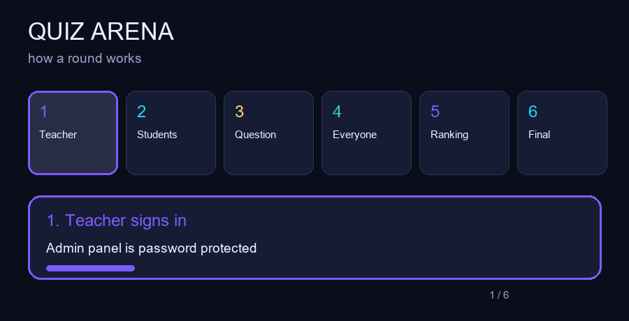
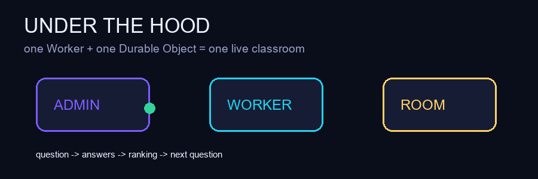
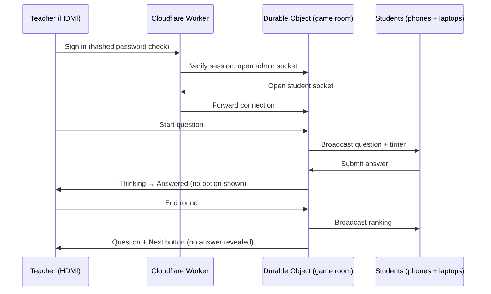

<div align="center">

# 🎮 Quiz Arena

### A live classroom quiz that feels like a game — running entirely on Cloudflare's edge.


**One link. 70 students. Zero servers to keep awake.**

</div>

---

## 🤯 Wait… how does this actually work?

You open a link. Students open the same link on phones and laptops. A question appears everywhere at the same moment. Everyone answers. The instant the last person submits, rankings appear on every screen. Nobody had to refresh. Nobody had to run a program on their computer.

That is the whole trick: **the "server" lives on Cloudflare, not on anyone's machine.**

<div align="center">



*↑ One round, six moments. Watch the progress bar.*

</div>

---

## 🧠 The 30-second explanation

| Who | What they do | What they see |
|---|---|---|
| **Teacher** | Signs in, starts the game, ends each round | Question only (safe to project on HDMI), live student status, joined count |
| **Students** | Enter name + roll number, answer each question | Question, timer, "wait for admin", ranking after the round |
| **Second laptop** | Signs in to the Review page | Every answer from every student, plus a CSV download |

The Teacher screen deliberately **hides the correct answer** while the quiz is live, because it is projected for everyone to see.

---

## 🔄 A round, step by step

1. **Teacher signs in** — email + password; the password is stored as a hash, never as plain text.
2. **Students join** from any device with a name and roll number. They are added to a shared room.
3. **Teacher starts a question.** It is broadcast instantly to every connected device.
4. **A timer runs.** MCQs are fixed at 30 seconds. Written questions use a teacher-set number of minutes.
5. **Students answer.** While a question is live, students receive *no score, no correctness and no ranking* — not even in browser devtools.
6. **Teacher ends the round** (or the timer expires). Every screen shows a ranking: position, name, roll number and points.
7. **Teacher presses Next.** Steps 3–6 repeat until the final podium appears.

If the teacher ends a round by mistake, **↩ Undo this round** restores the question, the answers and the scores.

---

## 🏗️ Under the hood

<div align="center">



*↑ Your code runs on Cloudflare. One Durable Object keeps everyone in sync.*

</div>



<details>
<summary><b>What is a Durable Object, in plain English?</b></summary>

It is a tiny always-on program that lives inside Cloudflare and remembers one thing very well: *this quiz room*. All students and the teacher connect to that same program. When one person sends a message, it decides who else should hear about it. Because it is a single coordinator, nobody's screen can drift out of sync.

</details>

<details>
<summary><b>Why not a normal website with a database?</b></summary>

A normal website needs a computer running all the time. If that computer sleeps, everybody's quiz dies. Here Cloudflare runs the program in dozens of locations, WebSockets stay open, and the room's state is stored durably. You do not own, patch or wake any machine.

</details>

---

## 🧩 Question types

The teacher can change *any* question from the Admin panel — type, text, options, correct answer and time.

| Type | What the student sees | How it is marked |
|---|---|---|
| **MCQ** | Four options, 30-second timer | Exact correct option |
| **Short answer** | A text box, teacher-set minutes | Accepted keyword alternatives |
| **Essay** | A larger text box, teacher-set minutes | Accepted keyword alternatives |
| **Paragraph + written** | A passage + text box | All required keywords must appear |
| **Paragraph + MCQs** | A passage + several MCQs in one round | Full credit if all are right, partial credit otherwise |

Keywords can include alternatives separated by `|`, for example:

```
Propagation|growth stage|chain grows
```

---

## 🛡️ Security without the scary words

- Passwords are **hashed**, so even the project files do not contain the real password.
- Sessions are signed cookies that browsers cannot read with JavaScript.
- Five wrong passwords pause sign-in for 15 minutes.
- A second admin tab is signed out — the HDMI screen stays under your control.
- A student opening a second tab is signed out on **both** tabs. Two times means that place is permanently blocked.
- A teacher can remove any student mid-quiz; that student sees a clear message and cannot rejoin.
- Correct answers and scores are withheld from students until the end.
- All input is checked on the server and escaped before display.

> No camera or microphone is used. Nothing watches students. The protections are about *fair play*, not surveillance.

---

## 💬 Feedback & 📊 Review

When a student leaves, a small form asks for a **1–5 rating** and a comment.

On a second laptop, open the **Review** page and sign in. It shows:

- every student's answer to every question
- who answered correctly and how many points they earned
- all feedback
- **Download answers (Excel CSV)** and **Download feedback (Excel CSV)**

The Review page is read-only, so it does not interfere with the teacher's single admin tab.

---

## 🚀 Hosting

The app is deployed as one Cloudflare Worker with static assets and one Durable Object. After deployment:

- **Students:** `https://<your-subdomain>/student`
- **Admin (projector):** `https://<your-subdomain>/admin`
- **Review (second laptop):** `https://<your-subdomain>/review`

No local server, no tunnel, no laptop that must stay awake. HTTPS is automatic.

<details>
<summary><b>Deployment commands (done once)</b></summary>

```bash
npm install
npx wrangler login
npm run deploy
```

`wrangler.jsonc` holds the runtime name, bindings and hashed login values. No personal details appear in this README.

</details>

---

## 💻 Local development

```bash
npm install
npx wrangler dev --port 8787
```

Then open `http://127.0.0.1:8787/admin` and `http://127.0.0.1:8787/student`.

## ✅ Tests

With `wrangler dev` running:

```bash
PORT=8787 ADMIN_PASSWORD="<your-password>" node test/smoke.cjs
PORT=8787 ADMIN_PASSWORD="<your-password>" node test/auto-end.cjs
PORT=8787 ADMIN_PASSWORD="<your-password>" node test/editor.cjs
PORT=8787 ADMIN_PASSWORD="<your-password>" node test/require-all.cjs
PORT=8787 ADMIN_PASSWORD="<your-password>" node test/tab-limit.cjs
PORT=8787 ADMIN_PASSWORD="<your-password>" node test/feedback-review.cjs
PORT=8787 ADMIN_PASSWORD="<your-password>" node test/remove.cjs
```

---

## 📁 What is in this repo

```
worker.js                 Worker + Durable Object game engine
wrangler.jsonc            Cloudflare configuration
public/                   Home, admin, student and review pages
assets/                   Animated README GIFs
questions.json            Starting question set
tools/                    GIF generator
test/                     End-to-end tests
deploy.bat                One-click deploy
```

<div align="center">

**Built for one classroom. Designed so nobody has to think about servers.**

</div>
